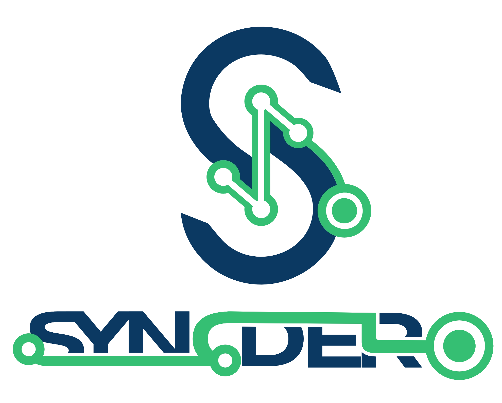

<p align="center">
  
</p>

# SYNCDERO

Sistema de control de versiones, auditoria criptografica y monitoreo de esquemas de bases de datos para MariaDB/MySQL, PostgreSQL y SQLite.

[](LICENSE)
[](https://php.net)
[](https://docker.com)

---

## 1. Descripcion General

SYNCDERO traslada la semantica y el flujo de trabajo de Git al ciclo de vida de las bases de datos relacionales. Permite auditar y sincronizar esquemas entre entornos heterogeneos (desarrollo local, servidores baremetal, contenedores Docker y preproduccion), garantizando inmutabilidad mediante sellado criptografico SHA-256 por archivo.

El sistema detecta cuando un script ya aplicado ha sido modificado en disco (alerta de Drift), permite agrupar ejecuciones en lotes secuenciales (Batches) y revertir de forma atomica el ultimo lote aplicado (Rollback). Cada ejecucion queda vinculada al commit y a la rama de Git del proyecto anfitrion.

---

## 2. Requisitos y Dependencias

### Entorno Standalone (Windows, Linux, macOS)
- PHP 8.2 o PHP 8.3 en CLI y Web.
- Extensiones PHP obligatorias (segun el motor utilizado):
  - `pdo`
  - `pdo_mysql` (para MariaDB y MySQL)
  - `pdo_pgsql` (para PostgreSQL)
  - `pdo_sqlite` (para SQLite)
  - `openssl` (para calculo de hashes criptograficos)
- Servidor web interno (`php -S`) o servidores de desarrollo como Laragon, XAMPP, Nginx o Apache.

### Entorno Docker
- Docker Engine 20.10+
- Docker Compose v2+

---

## 3. Instalacion y Puesta en Marcha

### Opcion A: Despliegue con Docker Compose

1. Clonar el repositorio:
   ```bash
   git clone https://github.com/Gibean/syncdero.git
   cd syncdero
   ```

2. Iniciar el servicio en segundo plano:
   ```bash
   docker compose up -d --build
   ```

3. Acceder al panel de control:
   Navegar a `http://localhost:8088` en el explorador web.

### Opcion B: Instalacion Standalone (Laragon / Windows / Linux)

1. Verificar que las extensiones PDO requeridas esten activas en `php.ini`:
   ```bash
   php -m | grep -E "pdo|pdo_mysql|pdo_pgsql|pdo_sqlite"
   ```

2. Instalar dependencias mediante Composer (o utilizar el autoloader fallback en `src/autoload.php`):
   ```bash
   composer install --no-dev --optimize-autoloader
   ```

3. Iniciar el servidor local para la interfaz web:
   ```bash
   php -S 0.0.0.0:8088 -t public
   ```

---

## 4. Configuracion de Servidores y Entornos

La configuracion principal reside en `config/syncdero.php`. Puede personalizarse mediante variables de entorno o agregarse graficamente desde el modal **Servidores** en el panel web.

Ejemplo de configuracion:

```php
return [
    'migrations_dir' => __DIR__ . '/../migrations',
    'backup_dir'     => __DIR__ . '/../backups',
    'repo_dir'       => __DIR__ . '/../.git',
    'apply_password' => getenv('SYNCDERO_APPLY_PASSWORD') ?: 'secret',

    'servers' => [
        'mariadb_host' => [
            'label'         => 'Servidor MariaDB Principal',
            'driver'        => 'mysql',
            'host'          => '127.0.0.1',
            'port'          => 3306,
            'user'          => 'root',
            'password'      => '',
            'auto_discover' => true,
            'protected'     => false,
            'role'          => 'dev',
        ],
        'postgres_host' => [
            'label'         => 'Servidor PostgreSQL Local',
            'driver'        => 'pgsql',
            'host'          => '127.0.0.1',
            'port'          => 5432,
            'user'          => 'postgres',
            'password'      => 'postgres',
            'database'      => 'app_db',
            'protected'     => true,
            'role'          => 'staging',
        ],
    ],
];
```

---

## 5. Referencia de la Interfaz de Linea de Comandos (CLI)

El ejecutable `bin/syncdero` provee control directo para administradores de sistemas y automatizacion en pipelines CI/CD:

| Comando | Descripcion |
| :--- | :--- |
| `php bin/syncdero status` | Muestra una tabla comparativa con el estado de sincronizacion de cada entorno. |
| `php bin/syncdero status --fail-on-divergence` | Finaliza con codigo de salida `1` si existe alguna alteracion en los hashes aplicados. |
| `php bin/syncdero status --format=json` | Exporta el estado estructurado en JSON para integracion con scripts y runners. |
| `php bin/syncdero sync <entorno> --dry-run` | Simula la ejecucion sin escribir en la base de datos ni generar backups. |
| `php bin/syncdero sync <entorno>` | Aplica las migraciones pendientes generando un snapshot previo en `backups/`. |
| `php bin/syncdero diff <entorno>` | Inspecciona discrepancias de hash (Drift) y muestra el contenido de scripts pendientes. |
| `php bin/syncdero rollback <entorno>` | Revierte el ultimo lote (batch) registrado en el entorno indicado. |
| `php bin/syncdero backup <entorno>` | Genera un volcado SQL manual del esquema en la carpeta `backups/`. |

---

## 6. Funcionalidades de la Interfaz Web

- **Lienzo de Nodos de Versionamiento:** Visualizacion cronologica de cada batch aplicado con cables curvos de flujo e indicacion del tiempo de ejecucion en milisegundos.
- **Boton de Ayuda Tecnica:** Acceso inmediato al manual tecnico integrado desde el icono `?` ubicado en la cabecera superior.
- **Alternador de Tema Claro y Oscuro:** Adaptacion de paleta cromatica corporativa (#0A3D72 Deep Blue, #2ECC71 Sync Green) con variantes vectoriales de imagotipo.
- **Visor de Diff e Inspeccion:** Al hacer clic en cualquier archivo de la lista de pendientes o divergencias, se despliega el codigo SQL, los hashes SHA-256 calculados y la advertencia de Drift.
- **Reversion por Lotes (Rollback):** Permite deshacer el lote de migraciones mas reciente directamente desde la barra superior, solicitando confirmacion o contrasena en entornos protegidos.
- **Enlace de Metadatos con Git:** Cada lote guarda de forma inmutable el identificador de commit (`git_commit`), la rama activa (`git_branch`) y notas de desarrollo ingresadas al momento de sincronizar.

---

## 7. Diagnostico y Resolucion de Errores Comunes

### Error: Extension PDO no encontrada (`could not find driver`)
- **Causa:** La extension PHP correspondiente al motor no esta habilitada en `php.ini`.
- **Resolucion:** Abrir el archivo `php.ini` activo y descomentar las lineas `extension=pdo_mysql`, `extension=pdo_pgsql` o `extension=pdo_sqlite`. Reiniciar el servidor web o terminal.

### Error: Divergencia detectada (`CONFLICT / DRIFT`)
- **Causa:** Un archivo `.sql` o `.php` en la carpeta `migrations/` fue editado despues de haber sido ejecutado en la base de datos.
- **Resolucion:** Inspeccionar el archivo con `php bin/syncdero diff <entorno>` o desde el panel web. Si el cambio fue un error, restaurar el contenido original mediante `git checkout migrations/nombre_archivo.sql`. Si el cambio es una nueva alteracion requerida, revertir el lote previo o crear un nuevo archivo de migracion incremental.

### Error: Tiempo de espera agotado (`Connection timed out`)
- **Causa:** El host configurado no esta encendido o un firewall bloquea el puerto (ej. 3306, 5432).
- **Resolucion:** La interfaz web utiliza verificacion asincrona desacoplada para evitar bloqueos del navegador. Verificar que el contenedor o servicio este en ejecucion y que la direccion IP sea accesible desde la maquina local.

### Error: Permisos de escritura en carpetas locales (`backups/`, `config/`)
- **Causa:** El proceso de PHP no posee privilegios para crear snapshots en disco.
- **Resolucion:** Asignar permisos de lectura y escritura en los directorios `backups/` y `config/` (`chmod -R 775 backups config` en Linux/macOS).

---

## 8. Licencia

Proyecto distribuido bajo la licencia MIT. Consulte el archivo `LICENSE` para mas detalles.
